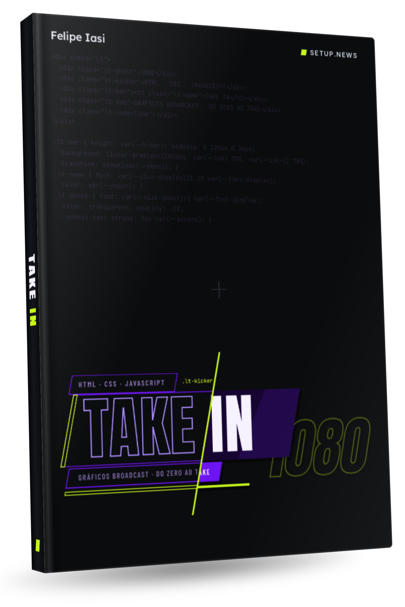

# TAKE IN — Gráficos broadcast em HTML, CSS e JavaScript



Arquivos do livro **TAKE IN**, de Felipe Iasi: os exercícios, os pacotes OGraf prontos e a errata.

## Como baixar

Clique em **Code → Download ZIP** e descompacte a pasta. Se você usa Git, clone o repositório:

```
git clone https://github.com/ficosta/takein-book.git
```

## O que tem aqui

| Pasta | Conteúdo |
|---|---|
| `exercises/` | Os exercícios, por capítulo (`ch04-html`, `ch05-css`…). |
| `exercises/lower-third/` | A lower third que atravessa o livro, passo a passo, do capítulo 4 ao 17. |
| `exercises/tools/` | O mini-controller, para testar gráficos OGraf no navegador. |
| `packages/` | Os pacotes prontos para instalar no edge.playout. |
| `ERRATA.md` | As correções do livro. |

Todo exercício tem duas pastas:

- `start/`: o ponto de partida, com as partes para você completar marcadas com `TODO`.
- `solution/`: o resultado. Se travar, abra, compare e siga.

## Para rodar

Abra a pasta `exercises/` no VS Code e use o Live Server, como no capítulo 3. Os gráficos OGraf rodam no edge.playout, o playout da setup.news.

## Errata

Encontrou um erro? Veja o `ERRATA.md`. Se ele ainda não estiver lá, abra uma issue neste repositório.

## Licenças de terceiros

As fontes (Anton, Barlow Condensed, Inter) seguem a SIL Open Font License, e o GSAP e o three.js seguem as licenças que acompanham cada um, nas pastas `fonts/` e `lib/`.
